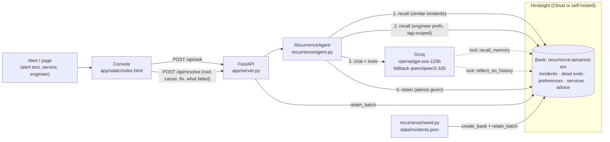

# Recurrence

**The on-call agent that remembers every outage.**

[](https://github.com/francisreubenr-rvu/recurrence/actions/workflows/tests.yml)
[](LICENSE)

It is 7:47 PM, UPI peak. `payments-api` is throwing 19% 5xx and HikariPool is exhausted. The engineer on call joined
in September. A generic assistant says what every runbook says: restart the pods, scale out. Both of those made this
exact outage *worse* three weeks ago.

Recurrence is an SRE incident assistant for **Tamarind Pay** (a fictional payments company; all data is synthetic).
It keeps the team's incident history in [Hindsight](https://github.com/vectorize-io/hindsight) long-term memory. When a
page comes in, it recalls the incidents that look like this one, the fixes that worked, the fixes that did **not**
work, and how this particular engineer likes to be helped. Then a Groq-hosted model answers with that memory in context.
When the page is resolved, the real outcome goes back into memory, so the next page starts smarter.

- Hindsight: [github.com/vectorize-io/hindsight](https://github.com/vectorize-io/hindsight)
- Hindsight docs: [hindsight.vectorize.io](https://hindsight.vectorize.io/)
- What agent memory is: [vectorize.io/what-is-agent-memory](https://vectorize.io/what-is-agent-memory)

> Status: prototype. The plumbing is tested offline (35 pytest tests, fake memory, template answers).
> **No live Hindsight or Groq call has been verified yet.** See [Limitations](#limitations).

---

## How Hindsight is used

One memory bank per team (`recurrence-tamarind-sre`). Tags scope every memory: `service:<name>`,
`engineer:<slug>`, `kind:incident|dead-end|preference|service|advice`. All calls go through the official
`hindsight-client` SDK in [`recurrence/memory.py`](recurrence/memory.py).

### create_bank: a skeptical, literal memory

```python
client.create_bank(
    bank_id="recurrence-tamarind-sre",
    name="Recurrence on-call memory",
    mission="I am the on-call memory for Tamarind Pay's SRE team. I remember every past incident: "
            "the alert, the logs, the root cause, the fix that worked, and the fixes that did NOT work...",
    disposition={"skepticism": 4, "literalism": 4, "empathy": 2},   # 1-5 scale
)
```

### retain: incidents, dead ends, preferences, and the agent's own advice

Each past incident becomes two memories: the narrative, and a separate "dead end" so that *what not to do* is
recallable on its own ([`recurrence/seed.py`](recurrence/seed.py)).

```python
client.retain_batch(bank_id=BANK, items=[
    {
        "content": "Incident INC-2087 (SEV1) on payments-api ... Root cause: ledger-svc 4.21.0 migration created an "
                   "index without CONCURRENTLY ... Fix that worked: pg_terminate_backend, roll back ledger-svc ...",
        "timestamp": "2026-10-15T19:55:00+05:30",          # when it happened, so recall can reason about time
        "context": "resolved incident postmortem for payments-api",
        "document_id": "INC-2087",
        "tags": ["service:payments-api", "engineer:arjun-mehta", "kind:incident"],
        "metadata": {"incident_id": "INC-2087", "service": "payments-api", "kind": "incident"},
    },
    {
        "content": "During INC-2087 on payments-api this did NOT work and should not be repeated: restarting "
                   "payments-api pods ... scaling the HPA made PgBouncer saturation worse.",
        "document_id": "INC-2087-dead-end",
        "tags": ["service:payments-api", "engineer:arjun-mehta", "kind:dead-end"],
        # ...
    },
])

# After every answer, the advice itself is retained, so the next page knows what was already tried.
client.retain(bank_id=BANK, content=f"Recurrence advised {engineer} on a {service} page ... Advice given: ...",
              context="advice given by the on-call agent (not yet confirmed as the fix)",
              timestamp=now.isoformat(), tags=[f"service:{service}", f"engineer:{slug}", "kind:advice"])
```

### recall: similar incidents, then this engineer's preferences

```python
incidents = client.recall(bank_id=BANK, query=f"{service}: {alert}",
                          max_tokens=2500, budget="mid", tags_match="any",
                          query_timestamp=now.isoformat())     # "weeks ago" is relative to the page

prefs = client.recall(bank_id=BANK,
                      query=f"How does {engineer} prefer to receive help during incidents?",
                      tags=[f"engineer:{slug}", "kind:preference"], tags_match="all_strict",
                      max_tokens=600, query_timestamp=now.isoformat())
```

Both result lists go into the system prompt with a "N days ago" label. The model can also call `recall_memory`
(scoped by `service:` tag) as a tool when it wants more.

### reflect: patterns across the whole history

Exposed to the model as the `reflect_on_history` tool and to people via `POST /api/patterns`:

```python
answer = client.reflect(bank_id=BANK,
                        query="What pattern links ledger-svc deploys to payments-api errors?",
                        budget="low")
print(answer.text)
```

---

## Architecture



Failure handling: if Hindsight is down the page still gets an answer (errors are listed in `memory_errors`);
if Groq is down the recalled memories are still returned. Groq `tool_use_failed` (HTTP 400) falls back to the second
model, then to a no-tools answer; malformed tool arguments and tool exceptions are returned to the model as tool
output instead of crashing ([`recurrence/llm.py`](recurrence/llm.py)).

---

## Repository layout

| Path | What is in it |
|---|---|
| `recurrence/` | Agent, Hindsight client wrapper, Groq client, config, seed script |
| `app/` | FastAPI server and the single-page console (`app/static/index.html`) |
| `data/incidents.json` | Synthetic incident history: 12 incidents, dead ends, preferences, service facts |
| `evals/` | Before/after evaluation (memory off vs on) and its output |
| `scripts/` | Learning curve from an empty bank (interaction 1 to 5) |
| `tests/` | 35 pytest tests; no network or keys needed |
| `docs/` | Offline plumbing-run log and internal submission notes |
| `content/` | Article, LinkedIn, and Reddit drafts (unpublished; not part of the app) |
| `video/` | Demo video script, shot list, thumbnail brief, upload copy |
| `run.sh` | Short commands for test, offline, seed, serve, eval, curve |

---

## Setup

Python 3.11+.

```bash
python -m venv .venv
source .venv/bin/activate
pip install -r requirements.txt
cp .env.example .env
```

### Option A: Hindsight Cloud

Create a key in the Hindsight Cloud UI, then in `.env`:

```
HINDSIGHT_API_URL=https://api.hindsight.vectorize.io
HINDSIGHT_API_KEY=<your Hindsight key>
GROQ_API_KEY=<your Groq key>
```

### Option B: self-host Hindsight with Docker

Hindsight needs its own LLM for fact extraction and reflect; this compose file points it at Groq.

```
GROQ_API_KEY=<your Groq key>
HINDSIGHT_API_URL=http://localhost:8888
HINDSIGHT_API_LLM_PROVIDER=groq
HINDSIGHT_API_LLM_API_KEY=<your Groq key>
HINDSIGHT_API_LLM_MODEL=openai/gpt-oss-120b
```

```bash
docker compose up -d          # API on http://localhost:8888, UI on http://localhost:9999
```

### No keys at all (plumbing only)

```bash
./run.sh test                 # full pytest suite, fake memory + template LLM, no network
./run.sh offline              # console at http://localhost:8000 with fake memory
```

`FakeMemory` and `OfflineLLM` are clearly labelled test stand-ins. Their output is prefixed
`[offline template, no LLM]` / `[offline reflect stand-in]` and must never be shown as Hindsight or Groq results.

### Write access and rate limits

`POST /api/resolve`, `POST /api/preference` and the advice write inside `POST /api/ask` change the
memory bank. Three settings control who can write and how hard the model endpoint is hit:

| Variable | Default | Behaviour |
|---|---|---|
| `RECURRENCE_WRITE_TOKEN` | unset | When set, write endpoints require an `X-Recurrence-Token` header with this value. |
| (no token) | | Offline mode allows writes so the local demo works. Live mode refuses them with 503. |
| `RECURRENCE_ASK_RATE_PER_MIN` | `30` | Per-client sliding window on `/api/ask`. Exceeding it returns 429 with `Retry-After`. |
| `RECURRENCE_TRUST_PROXY` | `0` | Set to `1` behind a trusted proxy so the rate limit keys on the first `X-Forwarded-For` address. |

Write errors are logged server-side with a request id; the response body carries only a generic
message and that id, never internal hostnames or SDK text.

### Ingest pages from Alertmanager or PagerDuty

`POST /api/ingest/alertmanager` and `POST /api/ingest/pagerduty` accept the systems' own webhook
bodies, normalise every alert into one page shape, dedupe repeats, and optionally triage inline.

| Step | Behaviour |
|---|---|
| Normalise | Alertmanager v4 `alerts[]` and PagerDuty v3 `event.data`. Service comes from a `service`/`app`/`job` label, engineer from `engineer`/`oncall`/`owner`. A field the payload did not send is left empty and listed in `missing`. |
| Dedupe | Keyed on the source fingerprint for `RECURRENCE_INGEST_DEDUPE_SECONDS` (default 300). A repeat is returned with `duplicate: true` and `seen_count`, and is not answered again. |
| Triage | Add `?answer=true` to run the agent on each new firing page and return the full answer under `answer`. Resolved pages and pages with no engineer are not answered; the latter carry a `skipped` reason. |
| Limits | Writes use the same `X-Recurrence-Token` gate as the other write routes, and inline triage uses the same `/api/ask` rate limit. Payloads over 256 KB are rejected with 413. |

```bash
curl -X POST "$BASE/api/ingest/alertmanager?answer=true" \
  -H "Content-Type: application/json" \
  -H "X-Recurrence-Token: $RECURRENCE_WRITE_TOKEN" \
  -d @alertmanager-webhook.json
```

Alertmanager side: add a `webhook_configs` receiver with `url: $BASE/api/ingest/alertmanager`.
The token header can be set with `http_config.authorization`.

## Seed and run

```bash
./run.sh seed                 # create_bank + retain 31 memories (12 incidents, dead ends, 5 preferences, service facts)
./run.sh serve                # http://localhost:8000
./run.sh eval                 # memory OFF vs ON on 5 demo alerts -> evals/results_hindsight_groq.json
./run.sh curve                # interaction 1 -> 5 from an empty bank (bank <id>-curve)
```

Hindsight extracts facts asynchronously on its side; give it a short while after seeding before the first recall.

---

## Demo flow (5 steps)

All times IST. The console's `now` field replays "today" as **Mon 9 Nov 2026, 7:47 PM** so the demo is repeatable.

1. **Memory off fails.** Paste DEMO-1 (`payments-api` 5xx 19.2%, `HikariPool-1 - Connection is not available`,
   `still waiting for AccessExclusiveLock ... database ledger`), engineer *Arjun Mehta*, toggle memory **off**.
   The answer is the generic runbook: check deploys, restart pods, scale out. Restart and scale-out are exactly the
   two moves that made this outage worse before.
2. **Memory on recalls an incident from weeks earlier.** Toggle memory **on**, same page. Recurrence recalls
   **INC-2087** (15 Oct, 24 days earlier) and **INC-2041** (24 Sep): a `ledger-svc` migration holding a lock on
   `ledger.entries` during evening peak. It leads with: find the blocking PID in `pg_stat_activity`,
   `pg_terminate_backend` it, roll back `ledger-svc`.
3. **A dead-end fix is avoided.** The answer says explicitly: do **not** restart `payments-api` pods (bought ~6-8
   minutes, then the pool refilled) and do **not** scale the HPA (more pods, more connections, PgBouncer saturates).
   In INC-2087 those two steps cost about 20 minutes.
4. **A preference is learned.** Arjun saves a preference in the console: *"step-by-step please, with how to verify each
   step"* (`POST /api/preference` → `retain` with `engineer:arjun-mehta`, `kind:preference`). Ask again: the answer is
   now numbered steps with a verify check after each. Switch the engineer to *Priya Raman* and the same page comes back
   rollback-first with copy-pasteable commands, because that is her stored preference.
5. **Close the loop.** Fill "resolve" with the real root cause, fix and what did not work (`POST /api/resolve` →
   `retain_batch`). Then ask *"What pattern links ledger-svc deploys to payments-api errors?"* through
   `POST /api/patterns` (`reflect`; there is no console button for it yet): the bank now has three occurrences to
   reason over.

`python -m scripts.learning_curve` shows the same arc from an empty bank: interaction 1 recalls nothing and gives
generic advice; by interaction 5 it recalls the earlier outages, the failed fixes and the stated preference.

---

## Tests and evaluation

```bash
python -m pytest -q
```

- `tests/test_memory_sdk.py`: `create_autospec(Hindsight)` checks every SDK call in `memory.py` against the real
  `hindsight-client` 1.2.0 signatures, and builds the SDK's own `MemoryItem` models from the seed data.
- `tests/test_fake_memory.py`: the offline stand-in (tag filters, `all`/`any`, empty queries, reflect label).
- `tests/test_agent.py`: memory on vs off, memory down, LLM down, resolve, preference learned then used.
- `tests/test_llm.py`: Groq error handling with a mocked client: `tool_use_failed` → fallback model → no-tools
  answer, connection errors, malformed tool args, tool exceptions, max tool rounds, `<think>` stripping.
- `tests/test_server.py`: FastAPI `TestClient` on `/health`, `/api/ask` (memory on/off), validation, other routes.

`python -m evals.before_after` runs five demo alerts with memory off and on and reports, per alert, whether the
expected incident ID appears in the recalled memories and in the answer. `python -m scripts.learning_curve` walks one
engineer through five pages from an empty bank, retaining the real outcome after each.

[`docs/offline_run.txt`](docs/offline_run.txt) holds the output of the offline seed, learning curve and eval. It is a
plumbing check with fake memory and a template LLM, **not** a result. No live-run numbers are published in this
repository yet.

---

## Content and video

[`content/`](content/) has the article, LinkedIn, and Reddit drafts, and [`video/`](video/) has the demo script, shot
list, thumbnail brief, and upload copy. These are submission drafts, not published pieces: some contain explicit
placeholders. See [`content/README_FIRST.md`](content/README_FIRST.md) before publishing any of them.

---

## Limitations

- **Synthetic data.** Tamarind Pay, its services, people and 12 incidents are invented, modelled on common production
  failures (lock-holding migrations, Kafka poison messages, cert expiry, JWKS rotation, OOMs). Nothing comes from a
  real company.
- **No live calls verified.** Every test and the offline run use `FakeMemory` (keyword overlap) and `OfflineLLM`
  (a string template). SDK call *signatures* are checked against `hindsight-client` 1.2.0, but no request has been
  sent to Hindsight Cloud, a self-hosted Hindsight, or Groq. Server-side behaviour (fact extraction, temporal recall,
  how `tags_match="all_strict"` treats untagged memories, `query_timestamp`) is untested.
- **The offline eval numbers mean nothing.** The template copies incident IDs from whatever was recalled, so
  "answer cites the right incident" is trivially 1.0 offline. Only quote numbers from a live run.
- **Retained advice can crowd recall.** Every answer is retained as `kind:advice`. In the offline learning curve,
  earlier advice ranks above the incidents it quotes. With real Hindsight this may need a `types` filter,
  a lower weight, or excluding `kind:advice` from the first recall.
- **No auth, no pager integration.** The console is a local demo: no login, no PagerDuty/Opsgenie webhook, no Slack.
  Alerts are pasted in.
- **Model behaviour unmeasured.** Tool-calling reliability of `openai/gpt-oss-120b` and `qwen/qwen3-32b` on Groq, and
  latency under a real page, have not been measured.

---

## Team

Aryan Dubey, Francis Reuben R, Gopreeth Saharsh, Rohith AD.

## License

[MIT](LICENSE).
